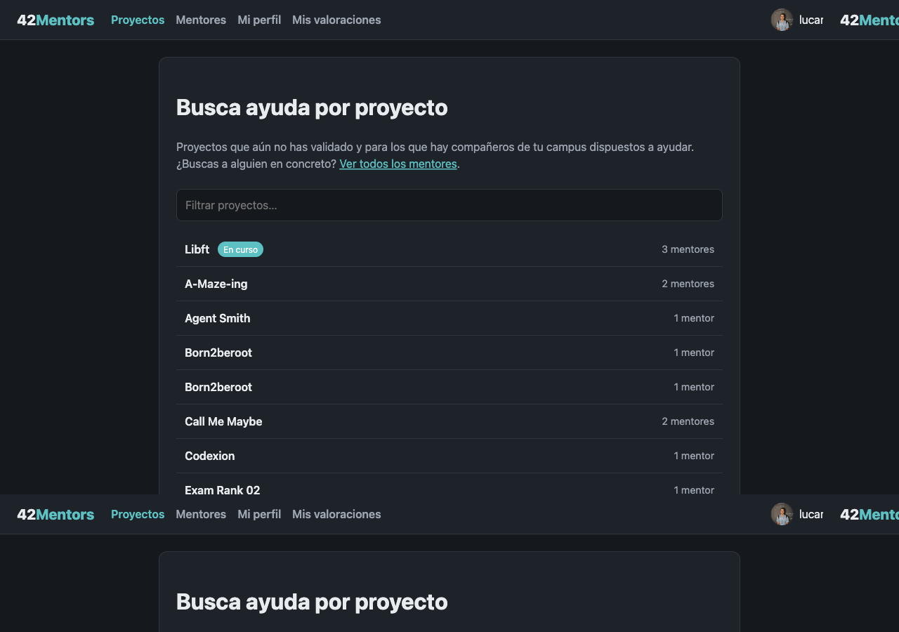
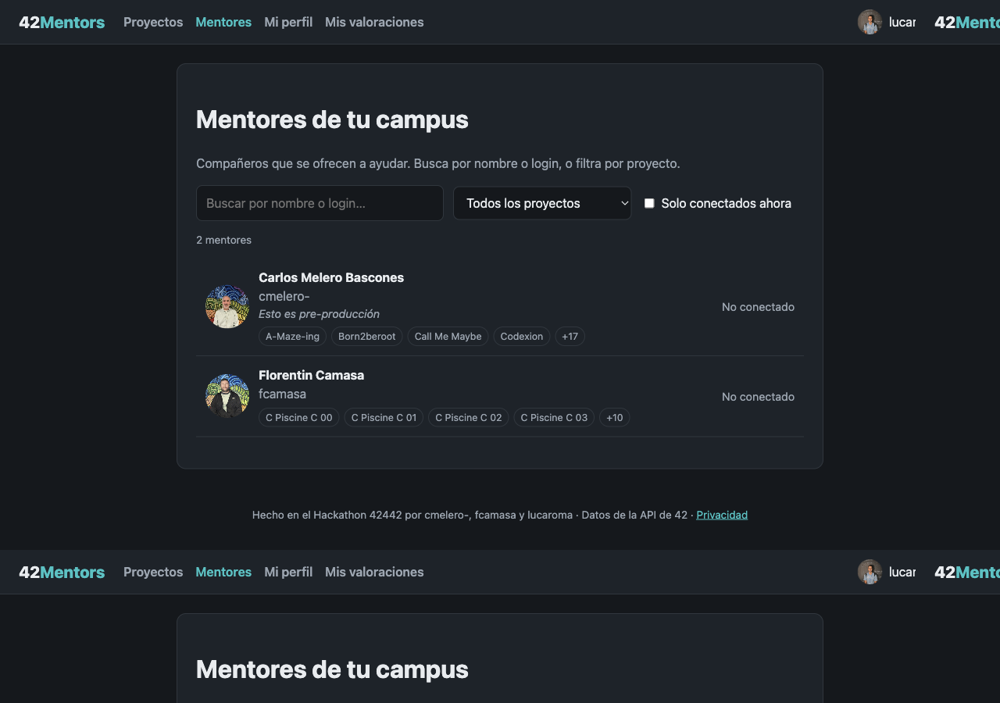
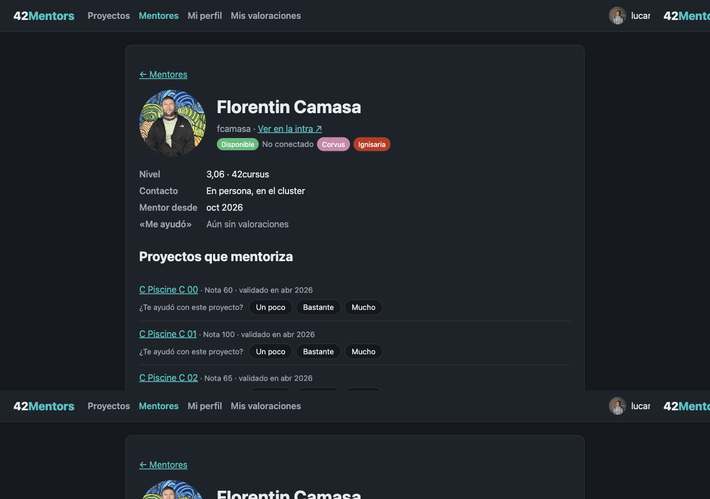
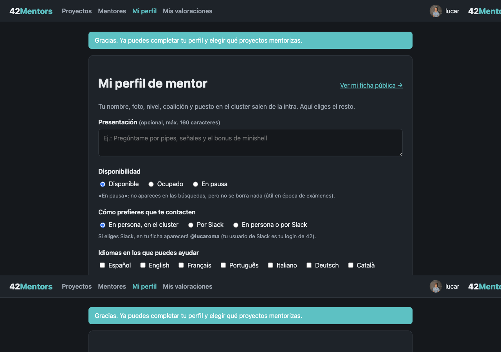
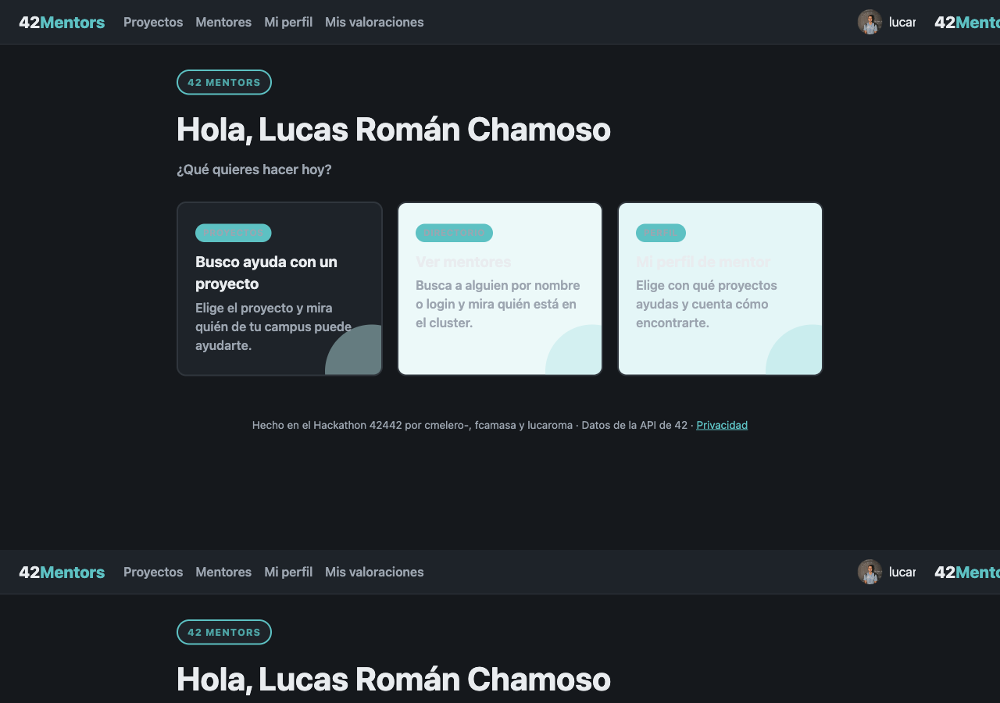

# 42 Mentors

Web para que los estudiantes de 42 encuentren compañeros que ya han validado el proyecto en el que están atascados, y para que quienes ya lo terminaron se ofrezcan a ayudar.

**A quién ayudamos:**
- al **estudiante atascado** en un proyecto, que no sabe quién de su campus lo ha validado y quiere ayudar;
- al **estudiante que ya lo validó** y quiere echar una mano, que no tiene dónde decirlo, más allá de un mensaje en Slack que se pierde.

Desplegado en **https://42mentors.com**. Por las condiciones de uso de la API de 42, todo el contenido está detrás del login con 42.

## Origen y participantes

El proyecto nació en el **Hackathon 42442** (42 Madrid, octubre de 2026). Lo empezaron:

| Login 42 | GitHub | Nombre |
|---|---|---|
| `cmelero-` | [`Carlos-mb`](https://github.com/Carlos-mb) | Carlos |
| `fcamasa` | [`Floren87`](https://github.com/Floren87) | Florentin |
| `lucaroma` | [`lucas-rcv`](https://github.com/lucas-rcv) | Lucas |

Algunos commits aparecen con otro nombre de autor en git (`ThisWeekapp` es Lucas y `Florentin Vasilica Camasa` es Florentin), pero GitHub los asocia a la cuenta correcta. Hoy lo mantiene Carlos.

## El problema

La lista de proyectos de 42 es cada vez más larga y compleja. Cuando un estudiante se atasca en un proyecto que nadie de su entorno conoce, no tiene una forma rápida de saber **quién de su campus ya lo ha validado** y está dispuesto a ayudar. La información existe en la intra, pero está dispersa y no indica quién quiere ayudar.

## La solución

1. **Login con 42:** OAuth2 de la API de 42, sin registro aparte.
2. **Mi perfil (mentor):**
   - marca con qué proyectos validados puede ayudar, con una nota opcional por proyecto. No se ofrecen los de la piscina, que ya no se hacen después de ella;
   - escribe una presentación;
   - indica su disponibilidad (*Disponible*, *Ocupado* o *En pausa*, que le oculta de las búsquedas);
   - indica cómo prefiere que le contacten (en el cluster o por Slack) y en qué idiomas.
3. **Proyectos (estudiante):** los proyectos que aún no ha validado y que tienen mentores en su campus, con los que tiene en curso primero. Al pulsar uno, ve los mentores con foto, nota sobre el proyecto y **puesto en el cluster si están conectados**.
4. **Mentores:** directorio del campus con buscador por nombre o login (sin importar las tildes), filtro por proyecto y filtro «conectados ahora».
5. **Ficha del mentor:**
   - datos de la intra: foto, nivel, coalición, puesto actual y nota y fecha de validación de cada proyecto que mentoriza;
   - lo que escribe el mentor: presentación, contacto, idiomas y notas;
   - «mentor desde» y enlace a su perfil de la intra;
   - los puntos «Me ayudó» que ha recibido, en total y por proyecto.

   El propio mentor ve además un botón para editarla.
6. **«Me ayudó»:** desde la ficha del mentor, el estudiante valora cuánto le ayudó con cada proyecto: «Un poco» (1 punto), «Bastante» (2) o «Mucho» (3). Los votos son **anónimos**: el mentor y los demás solo ven los totales. En **Mis valoraciones**, cada estudiante ve y cambia los suyos. Nadie puede votarse a sí mismo, y solo se vota a mentores del propio campus. Se puede apagar con `VOTES_ENABLED=False` en el `.env`: se oculta todo y los votos guardados se conservan.
7. **Mentores oficiales y manguitos** (Operación Manguito): cada persona se marca ella misma, después de aceptar el consentimiento, con un enlace privado que le manda el responsable (el administrador solo puede quitar la marca en `admin.php`). Un mentor oficial puede avisar de que está **disponible hasta la hora que indique** (como mucho 8 horas seguidas) y los manguitos (y los propios oficiales) ven en **Disponibles ahora** quién lo está, con su puesto en el cluster si está conectado. La disponibilidad caduca sola. Ser manguito solo lo ven la propia persona y el administrador.
8. **Listas siempre útiles:** no salen los mentores «en pausa» ni los que llevan **más de 30 días sin entrar**. Siempre aparecen primero los conectados, luego los disponibles y después los ocupados.
9. **En español e inglés:** por defecto, el idioma del navegador (inglés si no es ninguno de los dos). El selector ES · EN de la barra superior lo cambia en cualquier página, también antes de iniciar sesión y en el consentimiento.

## Así se ve

Capturas con cuentas de prueba. No aparecen nombres, logins ni fotos de otros alumnos.

**Proyectos** — los que aún no has validado y que tienen mentores en tu campus:



**Mentores** — directorio del campus:



**Ficha del mentor:**



**Mi perfil** — dónde el mentor elige disponibilidad, contacto, idiomas y proyectos:



Inicio, con sesión iniciada:



## Uso de la API de 42

| Para qué | Endpoint |
|---|---|
| Login | `/oauth/authorize` + `/oauth/token` (Authorization Code flow) |
| Datos del usuario, campus, cursus y proyectos (una sola llamada al entrar; los cursus sirven para reconocer los proyectos de la piscina) | `GET /v2/me` |
| Nombre y foto de los mentores en las listas (una llamada por cada 100 mentores) | `GET /v2/users?filter[id]=…` |
| Ficha del mentor: puesto, nivel y notas de sus proyectos | `GET /v2/users/:id` |
| Ficha del mentor: coalición | `GET /v2/users/:id/coalitions` |
| Quién está conectado y dónde (una llamada por campus, cacheada 2 min) | `GET /v2/campus/:id/locations?filter[active]=true` |

Límite de la API: 2 peticiones por segundo y 1200 por hora por app. Por eso se usa caché y se reintenta ante un 429.

## Privacidad (condiciones de uso de la API de 42)

- Solo se guarda el mínimo, y **solo tras el consentimiento explícito** de quien se ofrece como mentor o de quien vota:
  - id, login, campus y proyectos que mentoriza;
  - lo que el propio mentor escribe en su perfil;
  - las valoraciones «Me ayudó»: quién vota a quién, por qué proyecto, cuántos puntos y cuándo. Fuera de «Mis valoraciones», solo se muestran totales.
- El nombre, la foto, el nivel, la coalición, las notas de la intra y la ubicación se consultan a la API. Para no superar su límite, se guardan en una caché temporal del servidor, que se renueva como mucho cada hora y se borra al borrar los datos. El token de acceso vive solo en la sesión.
- Quien solo vota no aparece en ningún sitio: no tiene ficha ni sale en las listas.
- Toda la información está detrás del login con 42, con `noindex` y `robots.txt`.
- Página de privacidad con botón **"Borrar mis datos"**, que borra también las valoraciones hechas y recibidas.

## Cómo levantar el proyecto

### Requisitos
- PHP 8.1 o superior con las extensiones `curl` y `pdo_mysql`.
- MySQL o MariaDB.
- Una aplicación OAuth en la intra: https://profile.intra.42.fr/oauth/applications/new, con tipo *42 Community Development*, scope `public` y la Redirect URI apuntando a `callback.php`.

### Pasos
1. Crear una base de datos y ejecutar [`sql/schema.sql`](sql/schema.sql), por ejemplo desde phpMyAdmin. Si la base de datos ya existe de una versión anterior, aplicar en orden los ficheros de [`sql/migrations/`](sql/migrations/).
2. Copiar [`.env.example`](.env.example) como `.env` y rellenarlo con las credenciales de la app OAuth y de la base de datos.
3. Hacer que el servidor web sirva **solo la carpeta `public/`**. `src/`, `sql/`, `cache/` y `.env` deben quedar fuera de la parte pública. En local basta con `php -S localhost:8000 -t public` (Redirect URI: `http://localhost:8000/callback.php`).
4. Comprobar que `cache/` tiene permisos de escritura para PHP.
5. Abrir la web y entrar con 42. Para ofrecerse como mentor se va a «Mi perfil», que pide el consentimiento la primera vez. Para probar «Me ayudó» hacen falta dos cuentas, porque nadie puede votarse a sí mismo.

Para desarrollo en local con XAMPP y despliegue en el hosting, ver [DESARROLLO.md](DESARROLLO.md).

### Estructura
```
public/          Lo único accesible por web (páginas, CSS, JS, robots.txt)
src/             Lógica: configuración, BD, cliente de la API, sesión, cachés, votos, idiomas (src/lang/), vistas
sql/schema.sql   Esquema completo de la base de datos (instalaciones nuevas)
sql/migrations/  Cambios para bases de datos ya creadas (001–007)
cache/           Caché temporal de ubicaciones y perfiles de mentores (no se versiona)
tools/           Script que genera el paquete de despliegue (sin secretos)
.github/         CI: sintaxis PHP y búsqueda de secretos
.env.example     Plantilla de configuración (el .env real nunca se sube)
```

## Mejoras futuras

- **Ranking de mentores** por franjas de tiempo: semana, mes, 3 meses, año y desde siempre. Ya está preparado en la base de datos: cuenta la fecha del primer voto. Se podría renovar cada 6 meses, para que los primeros tengan que seguir ganándose el puesto.
- **Incentivos con el staff de 42** para quien más ayuda, por ejemplo días de compensación para los mejores del ranking en los proyectos más difíciles. Necesita implicar al staff.
- **Borrar automáticamente los datos de los mentores inactivos.** Hoy se ocultan a los 30 días, y sus datos se borran con «Borrar mis datos» o al cerrar el servicio.
- **Proyectos a los que el estudiante puede inscribirse**, con `/v2/users/:id/projects_users/registration`.
- **Dejar más claro dónde se activa el perfil de mentor:** hoy el consentimiento solo se pide al ir a «Mi perfil» o al votar.
- **Menú «hamburguesa» en el móvil:** en pantallas estrechas, las opciones del menú no caben y se cortan.
- **Número de correcciones** que ha hecho el mentor de cada proyecto (`scale_teams`). Necesita varias llamadas a la API por mentor.
